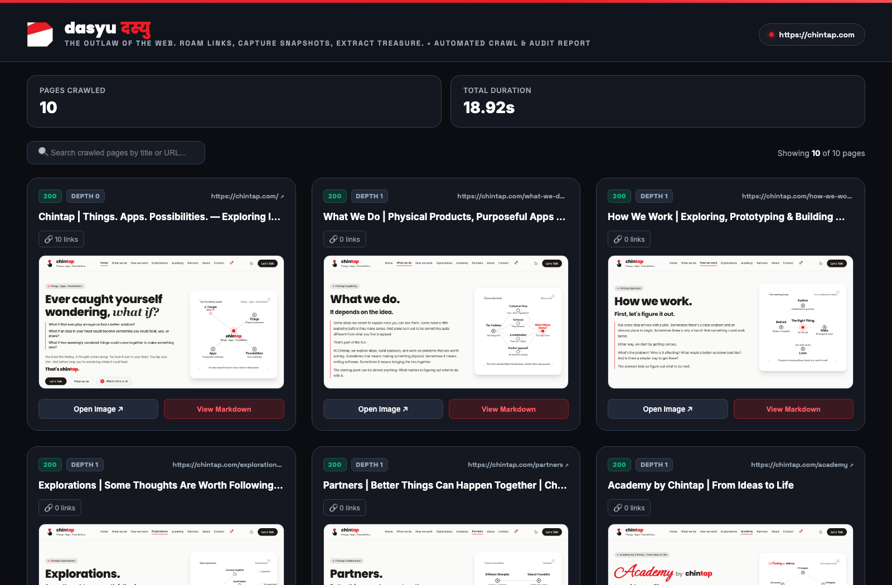
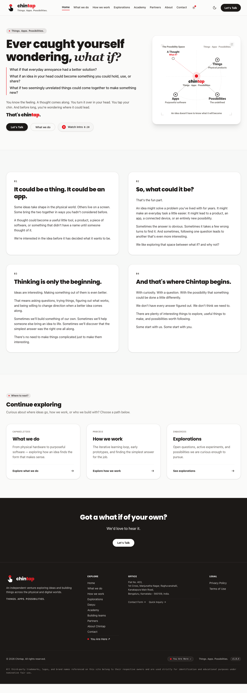
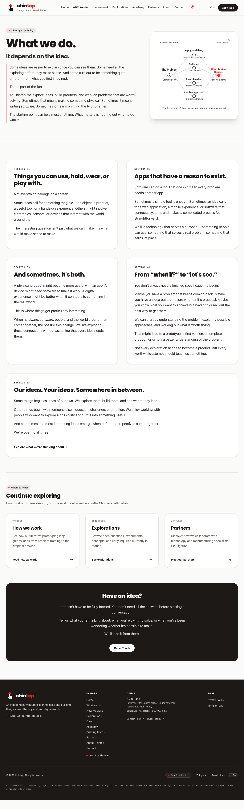
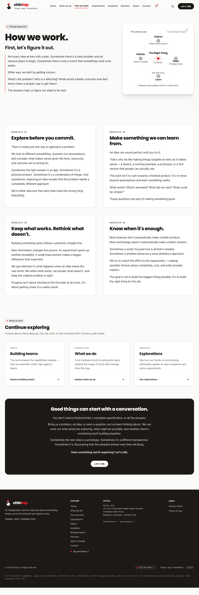
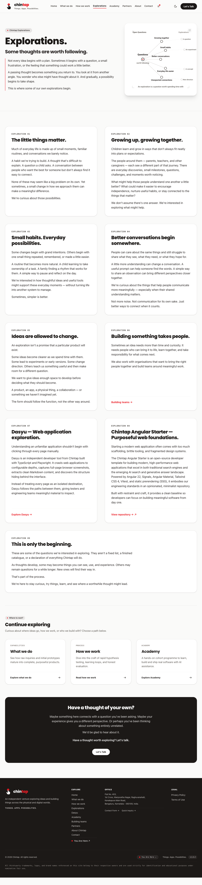

# Dasyu (दस्यु)

<p align="center">
  <picture>
    <source media="(prefers-color-scheme: dark)" srcset="./assets/dasyu-brand-horizontal-dark-2400.png">
    <source media="(prefers-color-scheme: light)" srcset="./assets/dasyu-brand-horizontal-2400.png">
    
  </picture>
</p>

> *The Outlaw of the Web. Roam links, capture snapshots, extract treasure.* A modern TypeScript/Node.js utility powered by Playwright to crawl web applications up to $N$ levels deep, capture full-page DOM screenshots, and extract clean Markdown content.

In Sanskrit, **Dasyu** (दस्यु) means a fierce non-conformist, rover, or outlaw who refused to submit to orthodox rules. **Dasyu** roams the information superhighway, bypassing fluff, capturing visual snapshots in time, and extracting raw content treasure.

---

## ✨ Features

- **Depth-Controlled BFS Crawler**: Crawl any web application with configurable depth ($1 \le N \le 5$). Includes URL normalization, deduplication, and same-origin filtering.
- **Full-Page DOM Screenshots**: Automatically captures visual layouts and full-page rendering using Playwright headless automation.
- **Markdown Content Extraction**: Converts raw HTML DOM structures into clean, readable Markdown and structured JSON metadata (title, description, headings, link graph).
- **Interactive Visual HTML Dashboard**: Generates a standalone, dark-themed responsive `report.html` dashboard with visual cards, search filtering, and zoom lightboxes.
- **Zero Orphaned Process Guarantee**: Centralized `BrowserManager` registry and automated process termination signal hooks (`SIGINT`, `SIGTERM`, `SIGHUP`, `beforeExit`) with timeout safeguards ensure Chromium instances are never left running or orphaned in the background.
- **Extensible Plugin Architecture**: Built on an asynchronous lifecycle hook system (`onPageLoad`, `onScreenshot`, `onExtract`, `onAnalyze`) ready for future plugins like accessibility auditing (WCAG via `@axe-core/playwright`), SEO audits, and performance profiling.
- **Dual CLI & Library**: Use directly from your terminal or import programmatically into your Node.js/TypeScript applications.

---

## 🚀 Installation & Setup (Local Beta)

> **Note:** Official NPM registry publishing is held on our Roadmap while we dogfood Dasyu internally. For now, install and run Dasyu directly from the cloned repository!

### Quick Start (Global CLI Link)

```bash
# 1. Clone the repository (or navigate to your local dasyu folder)
git clone https://github.com/chintap-india/dasyu.git
cd dasyu

# 2. Install dependencies & compile TypeScript
npm install
npm run build

# 3. Ensure Playwright browser binaries are ready
npx playwright install chromium

# 4. Link globally so `dasyu` and `dasyu-mcp` are available in any terminal:
npm link
```

Once linked, test your global installation anywhere:
```bash
dasyu --version
dasyu --help
```

### Running Locally Without Linking

If you prefer not to link globally, you can invoke the binaries directly:
```bash
# Run Dasyu CLI directly via Node
node ./bin/dasyu.js --help

# Run Dasyu MCP Server directly
node ./bin/dasyu-mcp.js
```

---

## 💻 CLI Usage

```bash
# Basic screenshot & crawl 1 level deep (default)
dasyu crawl https://chintap.com --output ./results

# Crawl 3 levels deep, generating full-page screenshots AND clean Markdown content reports
dasyu crawl https://chintap.com --depth 3 --content --output ./results

# Crawl an authenticated web app or dashboard using saved Playwright storageState cookies & localStorage
dasyu crawl https://today.chintap.com --auth ./auth.json --depth 2 --content

# Specify concurrency limit (default is 3 parallel pages)
dasyu crawl https://chintap.com --depth 2 --concurrency 5 --content

# Crawl and automatically open the interactive visual report in your browser
dasyu crawl https://chintap.com --depth 1 --content --a11y --seo --open

# Open the visual HTML crawl report or screenshots from any previous crawl
dasyu view
# Or view a specific output directory:
dasyu view ./demo-output/chintap
# Or reveal the output folder in macOS Finder / system file explorer:
dasyu view ./demo-output/chintap --finder

# Clean/reset generated output folders (wipes ./output and ./results by default)
dasyu clean
# Or clean a specific directory:
dasyu clean ./my-snapshots
```

### CLI Options

| Option | Description | Default |
| :--- | :--- | :--- |
| `-d, --depth <number>` | Crawl depth ($1 \le N \le 5$) | `1` |
| `-c, --concurrency <number>` | Max parallel browser pages | `3` |
| `-o, --output <dir>` | Output directory for screenshots & content | `./output` |
| `-O, --open` | Automatically open visual HTML report in default browser upon completion | `false` |
| `-s, --storage-state <path>` | Playwright `storageState` JSON path (cookies, localStorage) | `undefined` |
| `--auth <path>` | Alias for `-s, --storage-state` | `undefined` |
| `--content` | Extract clean Markdown content & JSON metadata | `false` |
| `--allow-external` | Allow crawling links outside starting domain | `false` |
| `--detect-auth` | Enable Anomalyco Browse plugin to monitor auth walls | `false` |
| `--seo` | Enable built-in SEO and metadata quality audit plugin | `false` |
| `--a11y` | Enable Axe-core WCAG 2.1 accessibility compliance audit plugin | `false` |
| `--rag` | Export extracted markdown to chunked JSONL for vector databases | `false` |
| `--graph` | Generate site link graph JSON and Mermaid flowchart diagram | `false` |
| `--delay <ms>` | Throttling delay between page requests in milliseconds | `undefined` |
| `--dismiss-modals` | Detect & auto-dismiss cookie banners & dialogs | `false` |
| `--debug` | Enable verbose debug logging | `false` |

---

## 📊 Interactive Visual HTML Dashboard

Every Dasyu crawl automatically generates a standalone, zero-dependency dark-mode **`report.html`** dashboard. Inspect crawl health, browse full-page screenshots, search pages in real-time, view extracted Markdown, and zoom in on visual artifacts with zero external network dependencies.

<p align="center">
  
</p>

### Dashboard Capabilities

- **Master Brand Header**: Displays the official Outlaw emblem lockup, active target URL pill with glowing live indicator (`• https://chintap.com`), and crawl timestamp.
- **KPI Summary Cards**: Real-time counter metrics highlighting **Pages Crawled**, **Total Duration**, **Avg A11y Score** (when `--a11y` is passed), and **RAG Chunks** (when `--rag` is passed).
- **Instant Search & Filter Bar**: Instant client-side search filtering by page title or URL with dynamic counter badges (`Showing 10 of 10 pages`).
- **Interactive Page Cards**:
  - **HTTP Status Badges**: Color-coded badges (`200 OK` in green, redirects in amber, errors in red).
  - **BFS Depth Badges**: Clear depth tracking tags (`Depth 0`, `Depth 1`).
  - **Direct Live Link**: One-click external navigation to live URL (`↗`).
  - **Link Counts**: Detected internal & external anchor count pill (`🔗 10 links`).
  - **Responsive Snapshot Previews**: Full-page screenshot cards with hover affordance (`Click to expand full-page screenshot`).
  - **Action Controls**:
    - **Open Image ↗**: View full-resolution screenshot directly.
    - **View Markdown**: Open modal lightbox displaying extracted Markdown text, article headings, and readability metrics.
- **Portable & Self-Contained**: The dashboard is generated as a single HTML file with embedded styles and fonts—perfect for sharing with teams, attaching to CI/CD artifacts, or publishing to static hosting.

To automatically open the report immediately after a crawl completes:
```bash
dasyu crawl https://chintap.com --open
# Or view any existing report:
dasyu view ./output
```

---

## 📸 Example Captured Snapshots (`chintap.com`)

Dasyu handles complex client-side rendered Single Page Applications, CSS animations, and modern typography out of the box. Below are real full-page snapshots automatically captured during a live depth-controlled crawl of [chintap.com](https://chintap.com):

| Page | Captured DOM Snapshot | Extracted Artifacts |
| :--- | :--- | :--- |
| **Homepage**<br>`https://chintap.com/` | <a href="./assets/examples/chintap-home.png"></a> | • Status: `200 OK` (Depth 0)<br>• Links Discovered: 10<br>• Snapshot: [chintap-home.png](./assets/examples/chintap-home.png) |
| **What We Do**<br>`https://chintap.com/what-we-do` | <a href="./assets/examples/chintap-what-we-do.png"></a> | • Status: `200 OK` (Depth 1)<br>• Purposeful software & physical products<br>• Snapshot: [chintap-what-we-do.png](./assets/examples/chintap-what-we-do.png) |
| **How We Work**<br>`https://chintap.com/how-we-work` | <a href="./assets/examples/chintap-how-we-work.png"></a> | • Status: `200 OK` (Depth 1)<br>• Prototyping & engineering pipelines<br>• Snapshot: [chintap-how-we-work.png](./assets/examples/chintap-how-we-work.png) |
| **Dasyu Product Page**<br>`https://chintap.com/dasyu` | <a href="./assets/examples/chintap-dasyu.png"></a> | • Status: `200 OK` (Depth 1)<br>• CLI, REPL & Auth Bridge documentation<br>• Snapshot: [chintap-dasyu.png](./assets/examples/chintap-dasyu.png) |
| **Explorations**<br>`https://chintap.com/explorations` | <a href="./assets/examples/chintap-explorations.png"></a> | • Status: `200 OK` (Depth 1)<br>• Architectural blueprints & labs<br>• Snapshot: [chintap-explorations.png](./assets/examples/chintap-explorations.png) |

---

## 🔐 Authenticated Crawling & Interactive Auth Bridge

Dasyu provides an **Interactive Auth Bridge** and native Playwright **`storageState`** integration. You can easily log in to authenticated web applications, dashboards, admin panels, and SSO portals directly through an interactive browser window without scripting complex login flows!

### 1. Interactive Headful Login (`auth login`)
Launch a real browser window, sign in, solve Multi-Factor Authentication (2FA/SSO), and Dasyu will automatically capture and persist the active session cookies & `localStorage`:

```bash
# Open interactive login window and save session to ./auth.json
dasyu auth login https://today.chintap.com/login

# Or specify a custom output path
dasyu auth login https://today.chintap.com/login -o ./my-session.json

# Now crawl the authenticated dashboard with your saved state
dasyu crawl https://today.chintap.com --auth ./auth.json --depth 2 --content
```

### 2. Session Inspection & External Import (OpenCode Browse / Chrome)
Easily inspect existing auth tokens or import cookies exported from OpenCode Browse (`anomalyco/browse`) or Chrome DevTools:

```bash
# Inspect cookies, active domains, and expiration dates
dasyu auth inspect ./auth.json

# Import cookies or raw session dumps from OpenCode Browse / DevTools into standard storageState
dasyu auth import ./browse-cookies.json -o ./auth.json
```

### 3. Anomalyco Browse Plugin (`--detect-auth`)
Enable the built-in **Anomalyco Browse Plugin** to monitor and alert on login walls, HTTP 401/403 status codes, and SSO redirects during autonomous crawls:

```bash
dasyu crawl https://today.chintap.com --auth ./auth.json --detect-auth
```

In the interactive REPL, you can run all auth commands on the fly:
```bash
dasyu> auth login https://today.chintap.com/login
✔ Logged in and saved session to "./auth.json"!
Session is now active for subsequent crawls in this REPL.

dasyu> auth inspect ./auth.json
dasyu> crawl https://today.chintap.com/dashboard --depth 2
```

---

## 🐚 Interactive REPL Shell

Running `dasyu` with no arguments launches an interactive, tomato-styled REPL shell where you can live-command the crawler and inspect results:

```bash
dasyu
# or: dasyu repl
```

Inside the `dasyu> ` prompt:
- `crawl <url> [depth]` — Crawls a website, taking snapshots and extracting Markdown. Supports flags like `--auth <path>`.
- `goto <url>` (or `snap <url>`) — Captures a one-off snapshot of a single page.
- `pages` (or `ls`, `list`) — Lists all pages captured in the current session.
- `inspect <index|url>` — Shows detailed JSON metadata, links, and file paths for a captured page.
- `auth <load|save|clear>` — Dynamically manage Playwright authentication storageState (cookies & localStorage).
- `config [key] [val]` — Views or live-updates crawler settings (concurrency, depth, outputDir, auth).
- `clean [dir]` (or `reset [dir]`) — Clears generated output directories and resets the session captured pages list.
- `clear` — Clears screen and prints the version banner.
- `exit` — Closes browser session and exits REPL.

Example REPL session with authentication:
```bash
dasyu> auth load ./my-cookies.json
✔ Loaded authentication storageState from "./my-cookies.json" for subsequent crawls

dasyu> config
Current Session Configuration:
  depth:          1 (max: 5)
  concurrency:    3 pages
  output:         ./output
  content:        enabled
  allow-external: disabled
  auth (storage): ./my-cookies.json

dasyu> crawl https://today.chintap.com/dashboard --depth 2
dasyu> clean
✔ Cleaned output directory (./output, ./results) and reset session pages.
```

*Note on SPAs*: Dasyu automatically waits for network idle (`networkidle`) and client-side rendering before capturing snapshots, ensuring Angular (`domtree.io`), React, and Vue applications render completely!

---

## 📚 Programmatic Library Usage

```typescript
import { DasyuCrawler } from 'dasyu';

async function main() {
  const crawler = new DasyuCrawler({
    startUrl: 'https://chintap.com',
    maxDepth: 2,
    concurrency: 3,
    extractContent: true,
    outputDir: './my-snapshots',
    storageState: './auth.json', // Authenticated crawl with Playwright storageState!
  });

  const report = await crawler.run();
  console.log(`Crawl finished! Captured ${report.pages.length} pages.`);
}

main();
```

---

## 🛡️ Reliability & Zero Orphaned Browsers

Dasyu is architected for strict process isolation and production reliability:
- **Centralized Registry**: Every browser launched across CLI, REPL, Auth Bridge, and MCP is registered in `BrowserManager.activeManagers`.
- **Guaranteed Cleanup via `try ... finally`**: Crawlers, interactive logins, and snapshot extractors wrap browser operations in strict `finally` blocks, ensuring resources are released even if plugins crash, network connections drop, or navigation times out.
- **Process Signal Hooks**: Automated hooks for `SIGINT` (Ctrl+C), `SIGTERM`, `SIGHUP`, and Node.js `beforeExit` gracefully terminate all active browser contexts and force-reap child Chromium processes with a timeout safeguard before the process exits.
- **Abortable Crawlers**: Crawlers provide `crawler.abort()` and `crawler.close()` methods for immediate and clean worker cancellation.

---

## 🤖 Model Context Protocol (MCP) Server for AI Agents

Dasyu includes a native **Model Context Protocol (MCP)** server over standard I/O (`stdio`), allowing AI coding agents (such as Antigravity, Claude Code, Cursor, OpenCode, Codex) to invoke deep crawling and visual snapshotting natively as tool calls.

### Launching the MCP Server
```bash
# Launch directly via CLI
dasyu mcp

# Or via the standalone bin executable
node ./bin/dasyu-mcp.js
```

### Agent Configuration Example
Add Dasyu to your agent's MCP settings (e.g. `.gemini/settings.json`, `claude_desktop_config.json`, or `.cursor/mcp.json`):

```json
{
  "mcpServers": {
    "dasyu": {
      "command": "node",
      "args": ["/absolute/path/to/dasyu/bin/dasyu-mcp.js"]
    }
  }
}
```

Available MCP tools:
- **`dasyu_crawl`**: Recursively crawls a target web app up to $N$ levels deep, captures DOM snapshots, extracts Markdown, and returns structured page summaries.
- **`dasyu_snapshot`**: Captures a one-off full-page screenshot and clean Markdown for any single URL.
- **`dasyu_inspect_auth`**: Inspects cookies, active domains, and expiration dates in a `storageState` JSON file.

---

## 🗺️ Roadmap & Future Plans

### 🏢 Organization & Repository
The official home of Dasyu is hosted under the **`chintap-india`** GitHub organization at [`github.com/chintap-india/dasyu`](https://github.com/chintap-india/dasyu) with the web homepage at [`chintap.com/dasyu`](https://chintap.com/dasyu).

### 📦 Hardening & NPM Registry Publishing
Public NPM publishing (`npm i -g dasyu`) is intentionally held while we dogfood Dasyu across internal web apps built in other threads. Releases and version bumps follow semantic versioning:
```bash
# Bump patch or minor version
npm run bump:patch
npm run bump:minor
```

### 🔌 Extensible Plugin Architecture & Capabilities
- **`Anomalyco Browse Plugin`** (`--detect-auth`): ✅ Completed (monitors login barriers, bot walls, and auth redirects).
- **`SEO & Quality Audit Plugin`** (`--seo`): ✅ Completed (audits headings hierarchy, meta descriptions, OpenGraph, canonical, and alt attributes).
- **`Accessibility (WCAG) Plugin`** (`--a11y`): ✅ Completed (integrates `@axe-core/playwright` for automated WCAG 2.1 compliance audits).
- **`RAG Semantic Chunking`** (`--rag`): ✅ Completed (generates heading-aware overlapping chunk embeddings in `./output/rag-chunks.jsonl`).
- **`Site Link Graph Generator`** (`--graph`): ✅ Completed (outputs relational graph JSON and Mermaid flowchart diagrams in `./output/site-graph.mmd`).
- **`Native MCP Server`** (`dasyu mcp`): ✅ Completed (Stdio JSON-RPC server powering AI agents in Gemini, Claude, and Cursor).

---

## 🎨 Brand Assets & Design System

Dasyu shares the clean, high-precision aesthetic of Chintap Studio and the Today app:

| Asset | Preview | Dimensions / Usage |
| :--- | :--- | :--- |
| **Dark Emblem (Vector)** | [`assets/dasyu-emblem-dark.svg`](./assets/dasyu-emblem-dark.svg) | Master dark mode emblem (Black body, Crimson slash) |
| **Light Emblem (Vector)** | [`assets/dasyu-emblem-light.svg`](./assets/dasyu-emblem-light.svg) | Master light mode emblem for dark surfaces |
| **Horizontal Brand (Dark)** | [`assets/dasyu-brand-horizontal-dark-2400.png`](./assets/dasyu-brand-horizontal-dark-2400.png) | 2400x800 high-res banner for dark backgrounds |
| **Horizontal Brand (Light)** | [`assets/dasyu-brand-horizontal-2400.png`](./assets/dasyu-brand-horizontal-2400.png) | 2400x800 high-res banner for light backgrounds |
| **OpenGraph Social Preview** | [`assets/dasyu-og.png`](./assets/dasyu-og.png) / [`.jpg`](./assets/dasyu-og.jpg) | 1200x630 card for Dasyu homepage and GitHub social previews |
| **Square Brand Graphic** | [`assets/dasyu-brand-dark-2048.png`](./assets/dasyu-brand-dark-2048.png) | 2048x2048 retina square presentation graphic |
| **Favicon & PWA Suite** | `favicon.png`, `apple-touch-icon-dark.png`, `pwa-icon-192.png`, `pwa-icon-512.png` | Web and mobile launcher icon package |

To re-render all high-resolution vector and raster assets using Google Chrome Headless and `sips`:
```bash
npm run build:assets
```
Asset exports are mirrored directly into `./public/images` to power the Dasyu web home page ([`chintap.com/dasyu`](https://chintap.com/dasyu)).

---

## 📄 License

MIT
